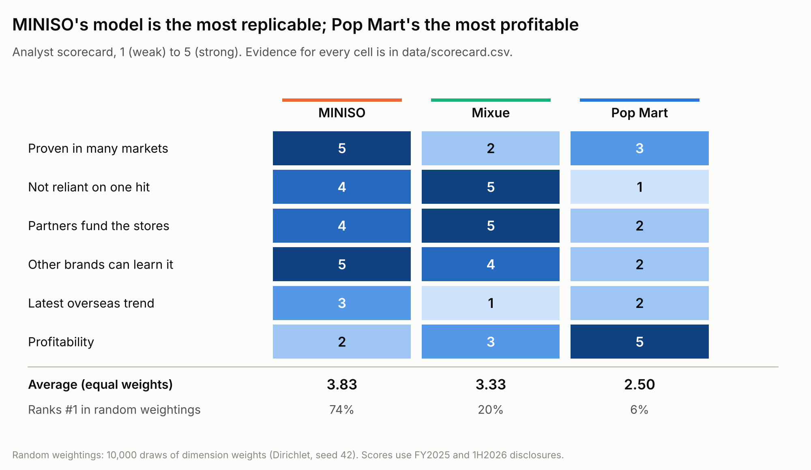
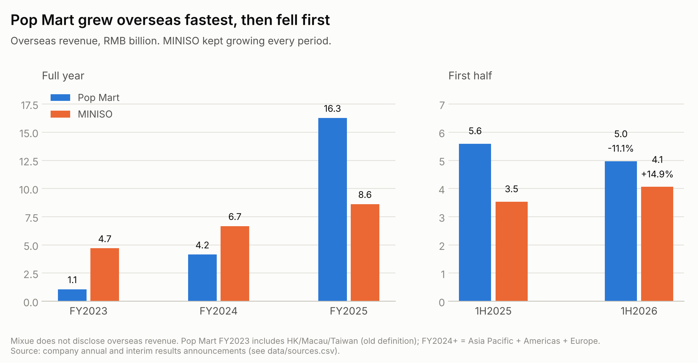
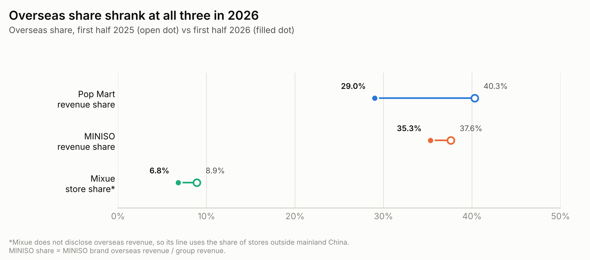
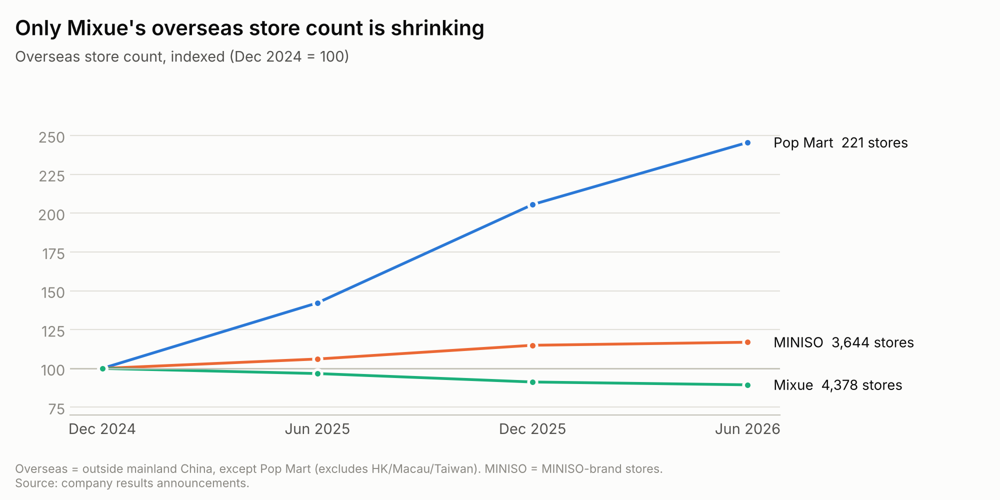
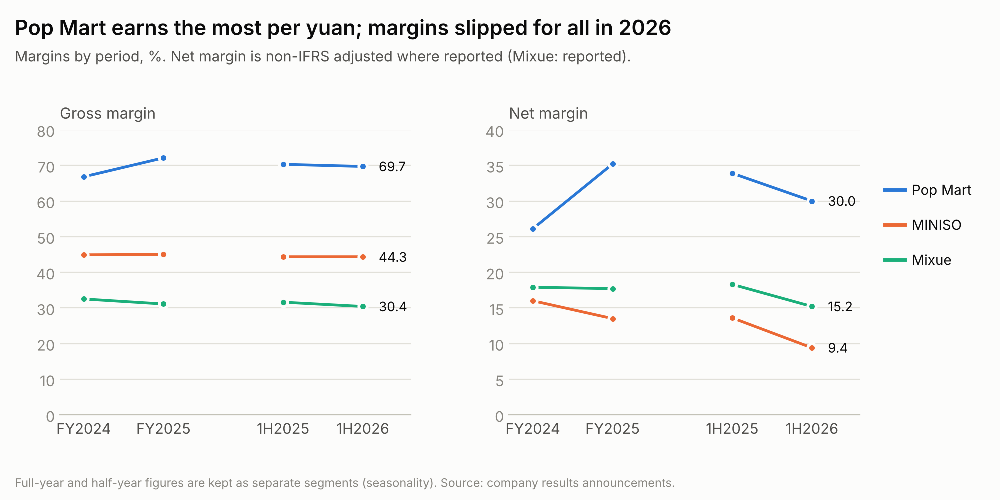

# Chinese Consumer Brands Going Global: Whose Model Travels?

**Pop Mart vs MINISO vs Mixue**, compared on public filings from FY2023 to the first half of 2026.

[中文版](README.zh-CN.md) · [Interactive scorecard](https://hql7-luo.github.io/china-brands-going-global/) · [Data sources](data/sources.csv)

---

## The answer

**MINISO's model is the most replicable. Pop Mart's is the most profitable, but the hardest to copy. Mixue's model works at home, but its first overseas wave has stalled.**



- **MINISO** is in 113 countries and regions with 3,644 overseas stores, and its overseas revenue grew in every period I looked at (RMB 4.7bn in FY2023 to 8.6bn in FY2025). It enters a market with distributors, then partners, then its own stores, so expansion does not depend on one hit product.
- **Pop Mart** had the biggest overseas jump (RMB 4.2bn to 16.3bn in one year) and by far the best margins (72.1% gross, 35.2% adjusted net in FY2025). But THE MONSTERS (LABUBU) was 38% of FY2025 revenue, and when it cooled, overseas revenue fell 11.1% in 1H2026.
- **Mixue** has the cheapest way to open a store (99.9% franchised), but overseas stores have fallen for three half-years in a row, to 4,378, with Indonesia and Vietnam both shrinking. It does not report overseas revenue.

"Replicable" here means two things: the company can keep repeating the model in new markets, and other Chinese brands could learn it. It is scored separately from "profitable", because the two point to different winners.

## Key findings

### 1. Pop Mart grew overseas fastest, then fell first



Pop Mart's overseas growth was driven largely by one IP (LABUBU) taking off in the US and Southeast Asia. MINISO's came from opening stores: slower, but it kept going in 1H2026 (+14.9%) while Pop Mart's reversed (-11.1%). MINISO's growth also slowed, and its overseas same-store GMV fell by a low single digit.

### 2. In 2026, all three leaned back on China



Comparing first halves, overseas share fell at every company. For Pop Mart the drop is large (40.3% to 29.0%) because China kept growing 47% while overseas shrank. The "go global" story is not over, but 2026 is a correction year for all three.

### 3. Only Mixue's overseas store count is shrinking



Pop Mart more than doubled its overseas stores from a small base (90 to 221). MINISO added stores slowly and plans a net cut of 50 to 70 overseas stores in 2H2026, mostly weak distributor stores. Mixue went from 4,895 to 4,378. As of Sep 2024, about 83% of its overseas stores were in Indonesia and Vietnam, so the first wave was really a two-country bet.

### 4. Pop Mart earns the most per yuan, and margins slipped for all three



Pop Mart's gross margin fell in 1H2026 partly because overseas, its highest-margin region, became a smaller share. MINISO's adjusted net margin dropped to 9.4%, mainly from FX losses and the up-front cost of new direct stores in the US.

### 5. Three different ways to make money from a store

| | Pop Mart | MINISO | Mixue |
|---|---|---|---|
| What it sells | Collectible IP toys | Low-priced design goods | Low-priced tea and ice cream |
| Overseas store model | Self-operated stores, plus online and vending | Distributor 66%, partner 12%, direct 22% | Franchise (99.9% of all stores) |
| Who pays for the store | Pop Mart | Mostly partners and distributors | Franchisees |
| Brand revenue per store, FY2025 | RMB 21.0m* | RMB 2.5m | RMB 0.6m |
| Overseas stores, Jun 2026 | 221 | 3,644 | 4,378 |
| Countries with stores | 20 | 113 | 17 |
| Gross margin, FY2025 | 72.1% | 45.0% | 31.1% |

\*Pop Mart: mainland China retail stores only (overseas per-store data is not disclosed). MINISO: brand revenue per store, a mix of retail and wholesale. Mixue: goods and equipment sold to franchisees per store. Calculated in `outputs/store_model.csv`.

Pop Mart books full retail sales from a few big stores. Mixue books supply sales from many small stores that franchisees pay for. MINISO sits in between, which is also why it can switch models market by market.

## What other Chinese brands can take from this

1. **Export the supply chain, not just the low price.** Mixue's price advantage comes from China-scale sourcing and dense store networks. Abroad it has to rebuild warehouses country by country (9 so far) while competing with local chains.
2. **Match the entry model to the market.** MINISO uses distributors for reach, partners in the middle, and its own stores where the brand matters (795, growing in North America). That ladder is what let it get into 113 markets.
3. **A hit IP speeds growth, but it is not a system.** Pop Mart's results show the upside and the risk of the same thing. A second IP that sells well overseas would change the picture.
4. **Watch same-store sales and partner inventory, not just store count.** MINISO's overseas stores grew while same-store GMV slipped, and overseas inventory turnover reached 273 days. Store count alone would have hidden this.

## What would change my view

- **Pop Mart:** another IP carries overseas growth without LABUBU. Twinkle Twinkle grew 580.6% in 1H2026, but the filing does not show how much of that was overseas.
- **MINISO:** North America reaches the ~10% net margin management is targeting for 2026, or distributor closures spread beyond the weak markets.
- **Mixue:** store count in Indonesia and Vietnam stops falling, and the new markets (Central Asia, Mexico, Brazil) start to scale.

## Method

**Data.** Revenue, margins and store counts for FY2023 to 1H2026, taken from each company's annual and interim results announcements (HKEX filings and press releases). Every number in [`data/reported_metrics.csv`](data/reported_metrics.csv) has a source ID, and [`data/sources.csv`](data/sources.csv) marks each source as primary (company filing) or secondary (news coverage of results).

**Definitions.** "Overseas" follows each company's own reporting, and they differ:

| Company | Overseas means | Note |
|---|---|---|
| Pop Mart | Asia Pacific + Americas + Europe | Excludes HK/Macau/Taiwan from FY2024. FY2023 uses the older "HK/Macau/Taiwan + overseas" line |
| MINISO | MINISO brand, overseas markets | TOP TOY is not split by region |
| Mixue | Stores outside mainland China | Overseas revenue is not disclosed |

**Scorecard.** Six dimensions, each scored 1 to 5 with the evidence written next to every score in [`data/scorecard.csv`](data/scorecard.csv). The scoring rules are in [`methodology.md`](methodology.md). Because weights are a judgment call, I also ran 10,000 random weightings: MINISO ranks first in 74% of them, Mixue in 20%, Pop Mart in 6%. Pop Mart only wins when profitability gets most of the weight.

**Checks.** [`analysis/check_numbers.py`](analysis/check_numbers.py) recomputes 13 figures the companies report themselves (growth rates, margins, store totals) and confirms they match.

**Limits.** The scorecard is an analyst judgment, not a model. Mixue's overseas revenue is not public, so its overseas picture relies on store counts. MINISO's overseas revenue mixes retail and wholesale. This is industry analysis, not investment advice.

## Run it

```bash
pip install -r requirements.txt
python analysis/build_metrics.py   # reported numbers -> comparable metrics
python analysis/make_charts.py     # charts/*.png
python analysis/check_numbers.py   # confirm numbers match company disclosures
```

```
data/          reported numbers, scorecard, sources
analysis/      three short Python scripts
outputs/       derived metrics (generated)
charts/        README charts (generated)
docs/          interactive scorecard page (GitHub Pages)
```

---

Independent project by [Haoqi Luo](https://hql7-luo.github.io). Data as of October 2026.
